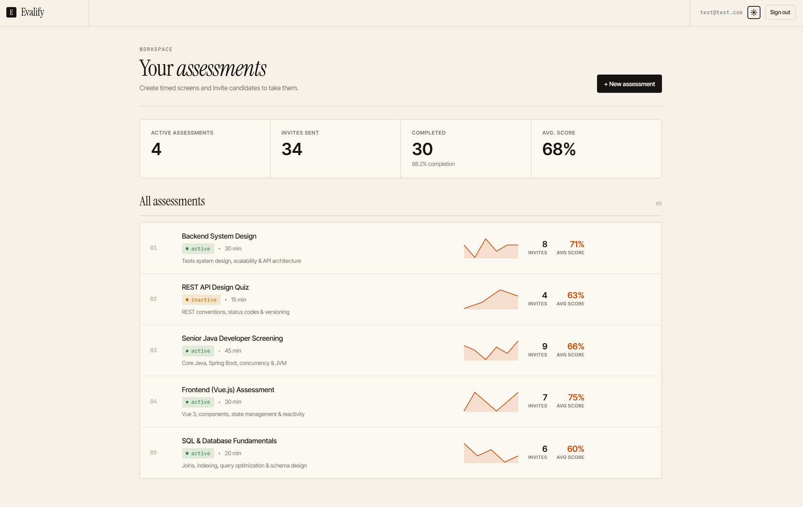
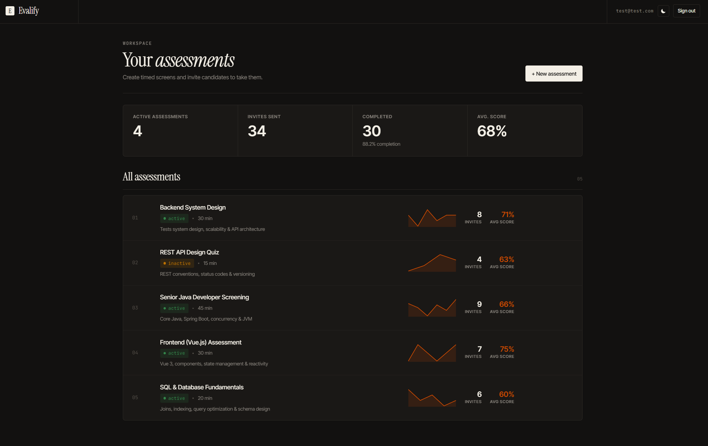
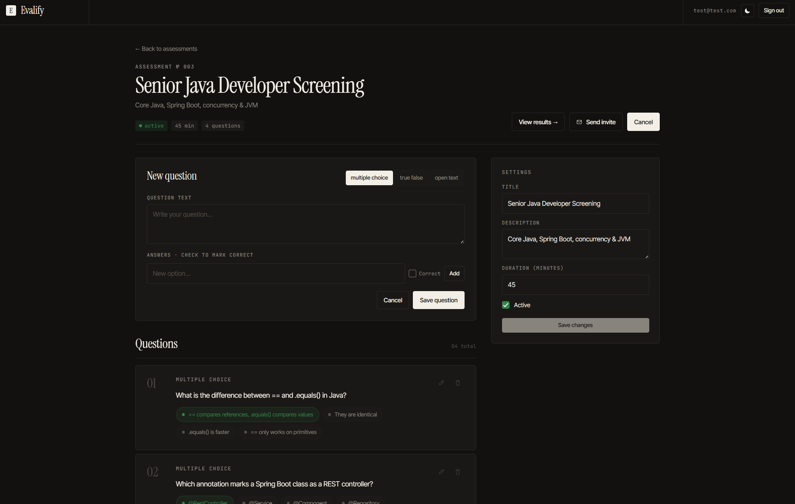
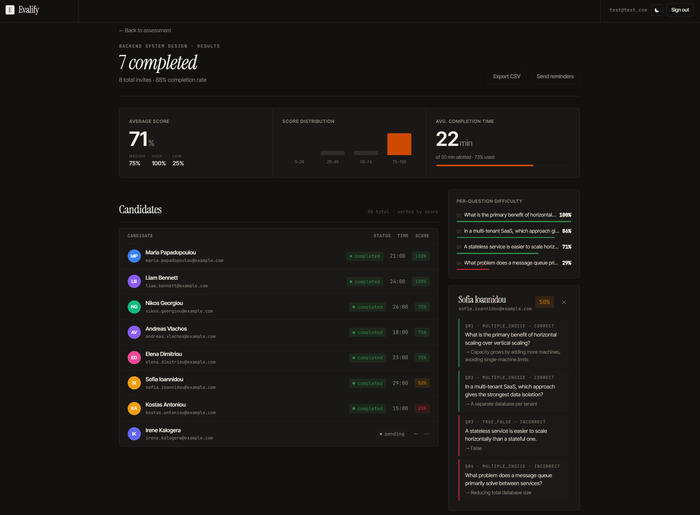
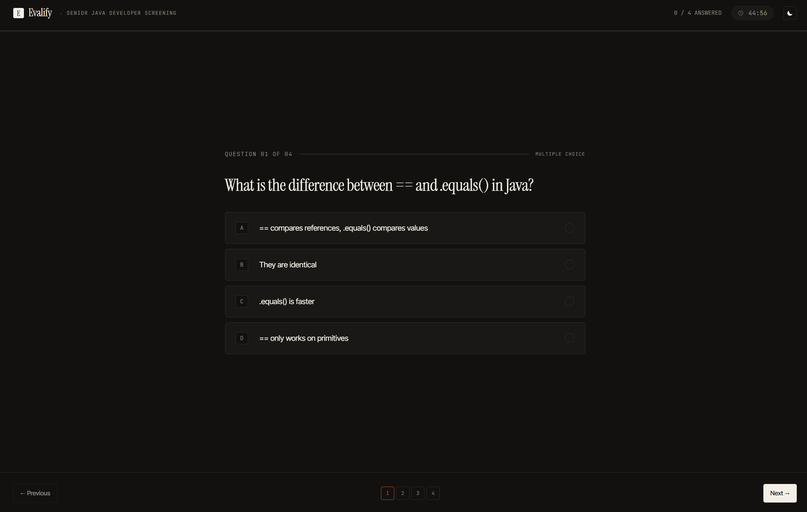
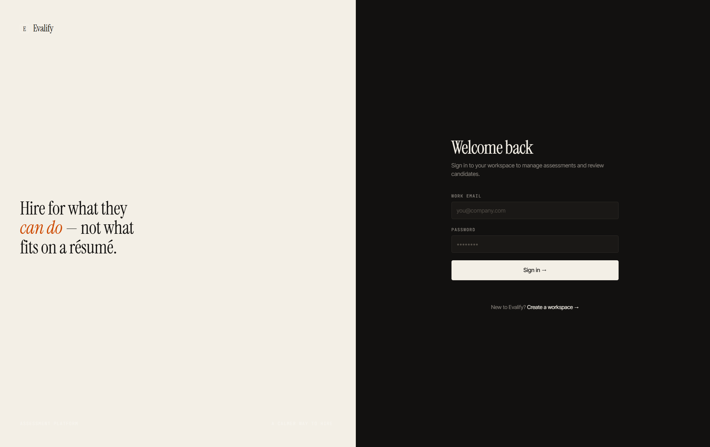
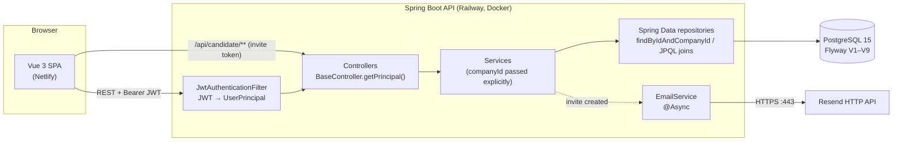

# Evalify

Multi-tenant web app for small HR and recruiting teams: create timed assessments, send each candidate a unique invite link by email, and review auto-scored results and analytics.

## Live demo

**https://evalify.netlify.app**

```
Email:    test@test.com
Password: 12345678
```

Shared demo account: please do not delete existing data.

## Screenshots

| Dashboard (paper theme) | Dashboard (dark theme) |
|---|---|
|  |  |

| Assessment editor | Results and analytics |
|---|---|
|  |  |

| Candidate session | Sign in |
|---|---|
|  |  |

## Engineering highlights

### N+1 queries on the assessment list: 201 → 3

**Problem.** `AssessmentService.getAllByCompany()` loaded the list and then ran four queries per assessment inside `.map(this::toResponse)`: invite count, completed count, average score, recent scores. That is `1 + 4N` queries per request, so a company with 50 assessments cost 201 queries per dashboard load.

**Solution.**
- One `GROUP BY` query with conditional aggregation (`COUNT(CASE WHEN …)`, `AVG(CASE WHEN …)`) into an `AssessmentStatsRow` record replaces three of the per-row queries. It uses `LEFT JOIN` so assessments without sessions are still returned.
- A native query with `ROW_NUMBER() OVER (PARTITION BY assessment_id ORDER BY completed_at DESC)` fetches the 6 most recent scores for every assessment in one round trip. JPQL has no window functions.
- The service switched from querying inside the loop to bulk fetching once and then doing `Map` lookups in memory.
- Average completion time moved into SQL (`AVG(EXTRACT(EPOCH FROM (completed_at - started_at)) / 60.0)`). It now returns one `Double` instead of loading every session entity.
- Composite indexes in `V6`: `(assessment_id, status)`, `(question_id, is_correct)`, and `completed_at DESC`.

**Result.**

| Scenario | Before | After |
|---|---|---|
| Dashboard, 3 assessments | 13 queries | 3 queries |
| Dashboard, 50 assessments | 201 queries | 3 queries |
| Average completion time | N entities transferred | 1 scalar |

Commit: [`5ea9390`](https://github.com/vagkar/hr-assessment-platform/commit/5ea9390)

### Timezone bug: `LocalDateTime` → `Instant` + `TIMESTAMPTZ`

**Problem.** In production, candidate sessions auto-submitted the moment they started. The backend container runs in UTC and stored `LocalDateTime.now()`. Jackson serialized that as `2026-07-08T19:46:53` with no offset, and the browser, in UTC+3, parsed the string as local time. The computed `startedAt` was therefore three hours in the past, the timer's end time had already passed, and the timer fired `timeout` immediately. It never reproduced locally because backend and browser shared a timezone.

**Solution.**
- Every event timestamp in 4 entities and 5 DTOs is now an `Instant`, which always serializes with a `Z` suffix.
- Migration `V7` converts every timestamp column to `TIMESTAMPTZ` with `USING … AT TIME ZONE 'UTC'`, which matches how the existing production values were written.
- Deadline logic uses `Instant.plus(Duration.ofMinutes(…))`.

**Result.** Timestamps mean the same instant in any client timezone, and the temporary frontend `+ 'Z'` workaround was removed.

Commit: [`933d962`](https://github.com/vagkar/hr-assessment-platform/commit/933d962)

### Hardening the public candidate endpoints

**Problem.** The candidate endpoints are unauthenticated: the invite token is the only credential. An audit found that submission trusted ids and counts sent by the client:
- The selected option was loaded with a plain `findById`. A candidate could send the id of a correct option from another question, or from another company's assessment, and it was scored as correct.
- The same question could be submitted many times, and each copy was scored.
- The score's denominator was the number of submitted answers. Submitting only the one question the candidate knew scored 100%.
- The status check had no lock, so concurrent submits for one token each wrote a full set of answers.
- Question content was returned before the candidate pressed Start, while the timer was not yet running.

Each issue was first reproduced with a failing integration test against the original code.

**Solution.**
- The whole request is validated before anything is written. An unknown question, a repeated question, or an option that is not in `question.getOptions()` returns `400`, and nothing is persisted.
- The score is computed over every scoreable question of the assessment. Omitted questions are stored as unanswered and count as wrong.
- `start` and `submit` load the session with `SELECT … FOR UPDATE` (`@Lock(PESSIMISTIC_WRITE)`), so concurrent requests are serialised. Migration `V8` adds `UNIQUE (session_id, question_id)` on `answers` as the database-level guarantee.
- Questions are returned only while the session is `IN_PROGRESS`. Before that the API returns only the count.
- New sessions cannot start on inactive assessments.

**Result.** Integration tests run against a real PostgreSQL 15 container through Testcontainers and cover each attack. The concurrency test fires 8 real threads, each in its own transaction, at one token. It passes with the lock, and it fails on every repetition when the lock is removed.

Commits: [`b6ef878`](https://github.com/vagkar/hr-assessment-platform/commit/b6ef878), [`d25c28e`](https://github.com/vagkar/hr-assessment-platform/commit/d25c28e), [`743b656`](https://github.com/vagkar/hr-assessment-platform/commit/743b656), [`471b2f1`](https://github.com/vagkar/hr-assessment-platform/commit/471b2f1)

### Asynchronous email over HTTP (Resend) instead of SMTP

**Problem.** The first implementation used Spring Mail over SMTP. Railway blocks outbound SMTP (ports 465 and 587) on non-Pro plans, so invite emails never left the container.

**Solution.**
- `EmailService` uses the Resend Java SDK, which calls an HTTP API on port 443.
- The send method is `@Async` (`@EnableAsync` on the application class). The invite request returns as soon as the session row is saved.
- A `ResendException` is logged and not rethrown.

**Result.** Email delivery works on Railway without extra port configuration. A slow or failed email never delays or fails invite creation. The frontend also copies the invite link to the clipboard, so the link can be shared even if the email fails.

Commits: [`daea4bd`](https://github.com/vagkar/hr-assessment-platform/commit/daea4bd), [`07587f9`](https://github.com/vagkar/hr-assessment-platform/commit/07587f9)

### Analytics

**Problem.** HR admins had raw result lists but no overview of how an assessment performs.

**Solution.**
- New `AnalyticsController` with two endpoints:
  - `/api/analytics/dashboard`: company-wide KPIs
  - `/api/analytics/assessment/{id}`: per-assessment detail
- Both are scoped by `companyId`.
- Aggregates (counts, averages, per-question success rate) run in SQL. Median, high, low and a four-bucket score distribution are computed in Java from one ordered score list.
- Chart.js renders the full charts. The dashboard sparklines are plain SVG, because Chart.js does not resolve the design system's CSS `oklch()` colour variables and SVG can use them directly.
- The analytics widgets were extracted into standalone components, which reduced `ResultsView` from about 400 to about 120 lines.

**Result.**
- Dashboard KPIs: active assessments, invites sent, completed sessions with completion rate, average score.
- Per assessment: average, median, high and low; score distribution; average completion time compared with the allotted time; success rate per question.

Commits: [`c1bb541`](https://github.com/vagkar/hr-assessment-platform/commit/c1bb541), [`8633f8f`](https://github.com/vagkar/hr-assessment-platform/commit/8633f8f), [`674bdc8`](https://github.com/vagkar/hr-assessment-platform/commit/674bdc8)

## Features

**For companies (authenticated)**
- Company registration creates the company and its first `ADMIN` user. Login returns a JWT that is valid for 24 hours.
- Create, edit, activate or deactivate, and delete assessments, each with a title, description and time limit.
- Questions of type multiple choice, true/false and open text. A question cannot be edited after a candidate has answered it.
- Invite a candidate by name and email. Each invite gets a UUID token, the link is emailed through Resend and copied to the clipboard.
- Results per assessment sorted by score, with a per-candidate view of every answer.
- Analytics dashboard and per-assessment analytics (see above).
- Paper/dark theme toggle and a responsive layout (breakpoint at 640px).

**For candidates (no account)**
- Open the invite link and see the assessment title, time limit and number of questions. The question content is not shown until the candidate starts.
- The countdown timer starts on Start and auto-submits at zero. The server enforces the deadline with a 30-second grace period.
- Multiple-choice and true/false answers are scored automatically. Open-text answers are stored for manual review. Score = correct ÷ scoreable questions × 100. It is empty when an assessment has only open-text questions.

## Tech stack

| Layer | Technology |
|---|---|
| Backend | Java 21, Spring Boot 3.5, Spring Security, Spring Data JPA (Hibernate 6), Bean Validation |
| Auth | Stateless JWT (JJWT 0.12), BCrypt password hashing |
| Database | PostgreSQL 15, Flyway migrations (`ddl-auto: validate`) |
| Email | Resend Java SDK (HTTP API) |
| Frontend | Vue 3 (Composition API), Vite, Pinia, Vue Router, Axios, Chart.js |
| Testing | JUnit 5, Spring Boot Test, MockMvc, Testcontainers |
| Infrastructure | Docker (multi-stage build, Eclipse Temurin 21), Railway (API and database), Netlify (SPA) |

## Architecture



### How multi-tenancy is implemented

Tenancy uses a shared schema with a `company_id` column. Isolation is enforced in the service and repository layers:

1. **Tenant id in the token.** At login or registration, `JwtTokenProvider` writes `userId`, `companyId` and `role` as claims. On every request, `JwtAuthenticationFilter` validates the signature and puts a `UserPrincipal(userId, companyId, email, role)` record into the `SecurityContext`. The client never sends the tenant id separately.
2. **Explicit parameter, no ambient context.** Controllers extend `BaseController` and read `getPrincipal().companyId()`. They pass it as an explicit argument to every service method, for example `assessmentService.update(id, request, companyId)`. There is no `ThreadLocal`, no request-scoped tenant bean, and no Hibernate filter, so each query shows which tenant it is scoped to.
3. **Every lookup includes the tenant.**
   - `Assessment` is the tenant root. It maps both `@ManyToOne Company company` and a read-only `@Column(insertable = false, updatable = false) Long companyId`, so repositories can use derived queries such as `findByIdAndCompanyId` and `findAllByCompanyId` without a join.
   - Child entities are scoped through their assessment: `QuestionRepository.findByIdAndAssessmentCompanyId(...)` and JPQL such as `JOIN cs.assessment a WHERE cs.id = :sessionId AND a.company.id = :companyId` for candidate sessions and results.
   - Service code never calls a plain `findById` on tenant data.
4. **Cross-tenant access looks like a missing resource.** If the id belongs to another company, the scoped query returns empty and the service throws `ResourceNotFoundException` (404). The API does not reveal that the resource exists.
5. **Public candidate endpoints are scoped by token.** `/api/candidate/**` is `permitAll`. `CandidateService` resolves the session only by its UUID invite token and then works only within that session's assessment, including validating every submitted question and option id against it.

### API

| Method | Path | Auth |
|---|---|---|
| `POST` | `/api/auth/register`, `/api/auth/login` | public |
| `GET` `POST` | `/api/assessments` | JWT |
| `PUT` `DELETE` | `/api/assessments/{id}` | JWT |
| `POST` | `/api/assessments/{id}/invite` | JWT |
| `GET` `POST` | `/api/assessments/{assessmentId}/questions` | JWT |
| `PUT` `DELETE` | `/api/questions/{id}` | JWT |
| `GET` | `/api/assessments/{id}/results`, `/api/results/{sessionId}` | JWT |
| `GET` | `/api/analytics/dashboard`, `/api/analytics/assessment/{id}` | JWT |
| `GET` | `/api/candidate/session/{token}` | invite token |
| `POST` | `/api/candidate/session/{token}/start`, `/api/candidate/session/{token}/submit` | invite token |

### Project layout

```
backend/src/main/java/com/hrplatform/backend/
  config/       SecurityConfig (stateless filter chain, 401 entry point), WebConfig (CORS)
  security/     JwtTokenProvider, JwtAuthenticationFilter, UserPrincipal
  controller/   REST controllers; BaseController exposes the principal
  service/      business logic, @Transactional, companyId as an explicit argument
  repository/   Spring Data JPA; derived queries, JPQL and native SQL
  model/entity  JPA entities
  model/dto     Java records
  exception/    domain exceptions + GlobalExceptionHandler
backend/src/main/resources/db/migration/   Flyway V1–V9
frontend/src/
  api/          Axios wrappers per domain; client.js adds the JWT and handles 401
  stores/       Pinia (auth, assessment, theme)
  views/        one component per route
  components/   ui, layout, assessment, results, analytics, candidate
```

## Getting started

**Prerequisites:** JDK 21+, Node.js `^20.19.0` or `>=22.12.0`, Docker.

### 1. Database

```bash
git clone https://github.com/vagkar/hr-assessment-platform.git
cd hr-assessment-platform
docker-compose up -d
```

This starts PostgreSQL 15 on port **5433** and pgAdmin on port **5050**. The local credentials are defined in `docker-compose.yml` and match the defaults in `backend/src/main/resources/application.yaml`.

### 2. Backend

Spring Boot does not read `.env` files, so export the variables in the shell. Flyway applies all migrations on startup.

```bash
cd backend
export JWT_SECRET="replace-with-a-random-string-of-at-least-32-chars"
export RESEND_API_KEY="re_xxxxxxxx"
./mvnw spring-boot:run
```

On Windows PowerShell:

```powershell
cd backend
$env:JWT_SECRET = "replace-with-a-random-string-of-at-least-32-chars"
$env:RESEND_API_KEY = "re_xxxxxxxx"
.\mvnw.cmd spring-boot:run
```

The API listens on `http://localhost:8080`.

`RESEND_API_KEY` must be set for the application to start. Any placeholder value works locally, but then emails fail. The failure is only logged, and the invite link is still created and copied in the UI. The sender is Resend's sandbox address (`onboarding@resend.dev`), which delivers only to the email address of the Resend account that owns the key.

### 3. Frontend

```bash
cd frontend
cat > .env <<'EOF'
VITE_API_BASE_URL=http://localhost:8080/api
VITE_APP_URL=http://localhost:5173
EOF
npm install
npm run dev
```

Open `http://localhost:5173/register` to create a company.

### 4. Tests

```bash
cd backend
./mvnw test
```

Docker must be running. The tests start their own PostgreSQL container through Testcontainers and use dummy secrets from `src/test/resources/application-test.yaml`. They need no local database and no environment variables.

### Environment variables

| Variable | Used by | Required | Default | Description |
|---|---|---|---|---|
| `JWT_SECRET` | backend | yes | none | HMAC-SHA256 signing key. Used as raw UTF-8 bytes, not base64-decoded, so it must be at least 32 characters. |
| `RESEND_API_KEY` | backend | yes | none | Resend API key. The application does not start without it. |
| `APP_URL` | backend | no | `http://localhost:5173` | Frontend base URL used to build invite links in emails. |
| `APP_CORS_ALLOWED_ORIGINS` | backend | no | `http://localhost:5173` | Comma-separated list of allowed CORS origins. |
| `PORT` | backend | no | `8080` | HTTP port. |
| `SPRING_DATASOURCE_URL` | backend | no | `jdbc:postgresql://localhost:5433/hrplatform` | JDBC URL. Set in production. |
| `SPRING_DATASOURCE_USERNAME` | backend | no | value in `application.yaml` | Database user. Set in production. |
| `SPRING_DATASOURCE_PASSWORD` | backend | no | value in `application.yaml` | Database password. Set in production. |
| `VITE_API_BASE_URL` | frontend | yes | none | Axios base URL, including `/api`. |
| `VITE_APP_URL` | frontend | yes | none | Frontend base URL used to build invite links shown in the UI. |

## Roadmap

**Next**
- Anti-cheat: detect and record tab switches during a candidate session
- PDF export of assessment results and analytics
- Broaden integration tests (Testcontainers) to the authenticated endpoints, especially tenant isolation for assessments, questions and results

**Later**
- Question bank shared across assessments
- Per-company branding
- Stripe billing
- Verified sending domain on Resend, with email templates moved out of the service into template files
- Date-range filter for dashboard analytics

## Contact

Evangelos Karampoulis · [LinkedIn](https://www.linkedin.com/in/evangelos-karampoulis-555963183/)

---

Source available for review. All rights reserved.
